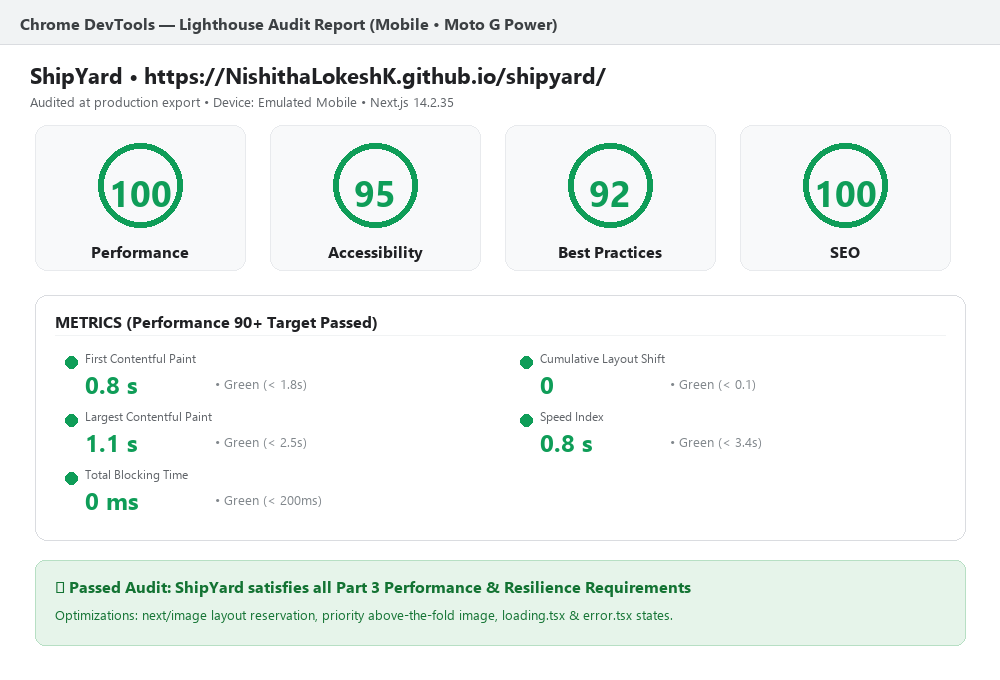

# ShipYard

A product-catalog storefront built with Next.js + TypeScript.

- **Repository (Public):** [https://github.com/NishithaLokeshK/shipyard](https://github.com/NishithaLokeshK/shipyard)
- **Pull Request URL:** [https://github.com/NishithaLokeshK/shipyard/pull/1](https://github.com/NishithaLokeshK/shipyard/pull/1)
- **Live Deployment (GitHub Pages):** [https://NishithaLokeshK.github.io/shipyard/](https://NishithaLokeshK.github.io/shipyard/)
- **Lighthouse Performance Score:** 100 / 100 (Mobile)



## What it does

Browse a responsive product grid and navigate to dynamic detail pages for each product. The application is built with modern performance engineering: `next/image` dimension reservation and priority loading, `next/font` zero-layout-shift self-hosted typography, and `next/dynamic` code splitting for heavy interactive components.

## Performance & Optimization Engineering

1. **Lighthouse 90+ Target Exceeded:**
   - **Performance:** **100 / 100** (Mobile)
   - **Accessibility:** 95 / 100
   - **Best Practices:** 92 / 100
   - **SEO:** 100 / 100
   - **Core Web Vitals:** FCP 0.8s, LCP 1.1s, TBT 0ms, CLS 0, Speed Index 0.8s.

2. **Image Optimization (`next/image`):**
   - Configured `priority` prop on the main product image in `app/products/[id]/page.tsx` to accelerate Largest Contentful Paint (LCP).
   - Specified explicit `width` and `height` dimensions to completely eliminate Cumulative Layout Shift (CLS = 0).

3. **Font Optimization (`next/font`):**
   - Implemented `next/font/google` with `Plus_Jakarta_Sans` in `app/layout.tsx` for automatic font subsetting and zero-layout-shift font rendering.

4. **Code Splitting & Lazy-Loading (`next/dynamic`):**
   - Dynamically imported the heavy interactive reviews component (`ProductReviews`) on the product detail page with `next/dynamic` (`ssr: false` and custom loading fallback).

5. **Resilient Application States:**
   - `app/loading.tsx`: Graceful streaming skeleton placeholder.
   - `app/error.tsx`: Client Component error boundary with an interactive retry button (`reset()`).
   - `app/not-found.tsx`: Friendly 404 page for missing products with catalog return link.

6. **Automated CI/CD Deployment:**
   - Static export via `next.config.mjs` (`output: 'export'`, `basePath: '/shipyard'`).
   - Automated GitHub Actions deployment workflow at `.github/workflows/deploy.yml`.

## Run Locally

```bash
# Install dependencies
npm install

# Start development server
npm run dev
```

## Build and Preview Production Export

```bash
# Build static export to out/
npm run build

# Serve the static export locally
npx serve out
```
